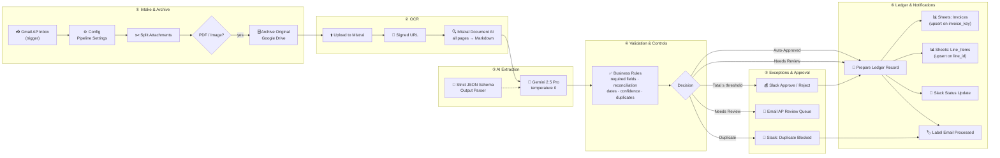

# Enterprise AI Invoice & Expense Automation

**Touchless Accounts Payable on n8n.** Invoices and receipts arrive in your inbox. Each one is read, validated against finance controls, routed for approval when needed and posted to your ledger, usually without anyone keying data in by hand.


---

## Executive Overview

Finance teams still re-type invoice data from PDFs into spreadsheets and ERPs. The work is slow, error-prone and costly to scale. Duplicate payments and missed early-payment discounts slip through because no one has time to check every document.

This workflow replaces that manual loop with a **six-stage, auditable pipeline**:

| Stage | What happens | Business control |
|---|---|---|
| **① Intake & Archive** | Watches a dedicated AP inbox, splits attachments and accepts PDFs and receipt photos | Every original is stored immutably in Google Drive |
| **② OCR** | Mistral Document AI converts every page to structured Markdown, tables included | Automatic retries on transient API failures |
| **③ AI Extraction** | Gemini 2.5 Pro (temperature 0) returns a record **locked to a strict JSON schema** | No free-text output; missing data becomes `null` and is never invented |
| **④ Validation** | Required fields, line-item → subtotal → total reconciliation, date checks, confidence gate | Bad data never reaches the ledger silently |
| **⑤ Exceptions & Approval** | Duplicates blocked, exceptions emailed to AP, high-value invoices approved in Slack with one click | Segregation of duties and duplicate-payment prevention |
| **⑥ Ledger & Alerts** | Idempotent upsert of invoice header and line items to Google Sheets, Slack status, Gmail label | Full audit trail: who, what, when, plus a link to the original |

### Extracted data model

| Group | Fields |
|---|---|
| **Vendor** | Name · **Tax ID** (VAT / EIN / GSTIN / ABN) · Address · Email |
| **Invoice** | **Invoice #** · Invoice date · Due date · PO # · Currency (ISO 4217) · Payment terms |
| **Line items** | Description · SKU · Quantity · Unit price · Tax rate · Line total |
| **Totals** | **Subtotal** · Tax · Shipping · Discount · **Total** |
| **Classification** | GL expense category (12-category enum) · Document type · AI confidence · Warnings |

### Business ROI

> Illustrative model. Replace the inputs with your own volumes and loaded labour cost.

| Input | Manual AP | With this workflow |
|---|---|---|
| Invoices per month | 1,000 | 1,000 |
| Handling time per invoice | ~8 min | ~1 min (exceptions only) |
| Staff hours per month | ~133 h | ~17 h |
| Cost at $40/h loaded | ~$5,300 / month | ~$700 / month + API usage |
| Cycle time (receipt → posted) | Days | Minutes |

**Value drivers your CFO will care about**

- **~85% fewer manual touches.** Staff handle exceptions, not data entry.
- **Duplicate-payment prevention.** Each invoice is fingerprinted on vendor identity plus invoice number.
- **Policy enforcement.** Approval thresholds and confidence gates are configuration, not tribal knowledge.
- **Faster close.** Line-item data with GL categories is ready for spend analytics on day one.
- **Audit-ready.** Every ledger row links back to the archived original and the n8n execution ID.

---

## Architecture



### Decision logic

| Decision | Condition | Outcome |
|---|---|---|
| `DUPLICATE` | Vendor + invoice # already processed | Slack alert, no ledger entry, email labelled |
| `NEEDS_REVIEW` | Any validation issue (missing field, totals don't reconcile, low confidence, credit note…) | Ledger row with status `NEEDS_REVIEW`, email to AP with the issue list |
| `APPROVAL_REQUIRED` | Clean extraction **and** total ≥ `approvalThreshold` | Slack Approve/Reject buttons (48 h window) → `APPROVED` / `REJECTED` / `APPROVAL_TIMEOUT` |
| `AUTO_APPROVED` | Clean extraction below threshold | Posted straight to the ledger as `APPROVED` |

---

## Repository Structure

```
├── workflows/
│   └── invoice_processing_pipeline.json   # Import this into n8n
├── .env.example                           # Reference config & credential checklist
├── .gitignore
├── LICENSE
└── README.md
```

---

## Setup & n8n Import

### Prerequisites

- n8n **1.90+** (self-hosted or n8n Cloud). The instance must be reachable over HTTPS for the Slack approval buttons.
- Google Workspace account (Gmail, Drive, Sheets)
- [Mistral API key](https://console.mistral.ai/) (OCR)
- [Google Gemini API key](https://aistudio.google.com/app/apikey)
- Slack workspace with a bot token (`chat:write`, `channels:read`)

### Step 1: Prepare Google Workspace

1. **Gmail:** create the label `ai-invoice-processed`. Copy its label ID (open n8n → Gmail node → *Get Many Labels*, or use the Gmail API explorer).
2. **Drive:** create a folder such as `AP / Invoice Archive`. Copy the folder ID from its URL.
3. **Sheets:** create a spreadsheet with two tabs and these header rows:

   **`Invoices`**
   ```
   invoice_key | status | vendor_name | vendor_tax_id | invoice_number | invoice_date | due_date | po_number | currency | subtotal | tax_total | shipping_total | discount_total | total | expense_category | document_type | confidence | line_item_count | issues_text | warnings_text | drive_link | file_name | processed_at | execution_id | email_message_id
   ```

   **`Line_Items`**
   ```
   line_id | invoice_key | invoice_number | vendor_name | line_number | sku | description | quantity | unit_price | tax_rate | line_total | currency | expense_category
   ```

### Step 2: Import the workflow

1. In n8n, open **Workflows → Add workflow → ⋯ menu → Import from File**.
2. Select `workflows/invoice_processing_pipeline.json`.
3. The workflow opens as **Enterprise AI Invoice & Expense Automation** (inactive).

### Step 3: Create credentials

Create these credentials and select them on the matching nodes (names are pre-filled as placeholders):

| Credential name | n8n type | Used by |
|---|---|---|
| `Enterprise AI Invoice · Gmail (AP Inbox)` | Gmail OAuth2 | Trigger, review email, label |
| `Enterprise AI Invoice · Google Drive` | Google Drive OAuth2 | Archive nodes |
| `Enterprise AI Invoice · Google Sheets` | Google Sheets OAuth2 | Ledger nodes |
| `Enterprise AI Invoice · Mistral API` | **Header Auth** → Name `Authorization`, Value `Bearer <MISTRAL_API_KEY>` | 3 OCR nodes |
| `Enterprise AI Invoice · Google Gemini API` | Google Gemini (PaLM) API | Gemini model |
| `Enterprise AI Invoice · Slack` | Slack API (bot token) | Alerts & approvals |

### Step 4: Configure the pipeline

Open **`Config · Pipeline Settings`**. It is the only node you need to edit:

| Setting | Default | Purpose |
|---|---|---|
| `approvalThreshold` | `5000` | Totals at or above this need Slack sign-off |
| `confidenceThreshold` | `0.85` | Below this, the invoice goes to manual review |
| `amountTolerance` | `0.02` | Rounding tolerance for reconciliation (or 0.5% of amount, whichever is larger) |
| `requireTaxId` | `true` | Set `false` for receipt-heavy expense flows |
| `defaultCurrency` | `USD` | Used when the document has no currency |
| `slackChannel` | `#ap-invoices` | Alerts and approvals |
| `apTeamEmail` | `accounts-payable@…` | Exception queue |
| `googleSheetId` / `driveArchiveFolderId` / `processedLabelId` | placeholders | IDs from Step 1 |

### Step 5: Test, then activate

1. Send a sample invoice PDF to the AP inbox.
2. Click **Test workflow** and inspect each stage's output.
3. Toggle the workflow **Active**. Duplicate detection persists only in production executions (n8n workflow static data).

### Customising

- **Different LLM:** swap the Gemini node for OpenAI, Anthropic Claude or Azure OpenAI. The schema parser and prompts are model-agnostic.
- **ERP instead of Sheets:** replace the two ledger nodes with QuickBooks, Xero, NetSuite or SAP (HTTP) nodes. `Ledger · Prepare Record` already outputs a flat, ERP-ready object.
- **Stricter policies:** add rules in `Validate · Apply Business Rules`, e.g. vendor allow-list or PO matching. Each rule pushes a message to `issues`.

---

## 🎬 2-Minute Client Demo Script

> **Setup before the call:** n8n canvas open, Google Sheet visible in a second tab, Slack `#ap-invoices` open, three prepared emails in drafts: (A) a clean $1,240 SaaS invoice, (B) a $12,800 consulting invoice, (C) a re-send of invoice A.

| Time | On screen | What you say |
|---|---|---|
| **0:00 – 0:15** | Title slide → n8n canvas, zoomed out | "Your AP team spends hours every week re-typing invoices. This is the pipeline that does it for them, from inbox to ledger, with your finance controls built in." |
| **0:15 – 0:30** | Pan across the six coloured sections | "Six stages: intake, OCR, AI extraction, validation, approval, ledger. Everything is visible, editable and auditable. No black box." |
| **0:30 – 0:50** | Send email **A**. Execution runs live; click the AI node output | "I've just emailed a standard invoice. It's archived to Drive, OCR'd, and the AI returns vendor, tax ID, invoice number, line items and totals in a strict schema. If a field isn't on the page, it's null. The AI never guesses." |
| **0:50 – 1:05** | Switch to Google Sheet: new row in `Invoices`, rows in `Line_Items`; Slack ✅ message | "Under the approval limit and fully reconciled, so it's posted automatically: header and every line item, GL category assigned, with a link back to the original." |
| **1:05 – 1:25** | Send email **B** → Slack shows **Approve / Reject** → click *Approve* | "This one is $12,800, above our $5,000 policy. The controller gets a one-click approval in Slack. I approve, and it lands in the ledger as APPROVED with a timestamp." |
| **1:25 – 1:40** | Send email **C** → Slack 🚨 duplicate alert | "Now a vendor sends the same invoice twice. It's caught on vendor plus invoice number and blocked before anyone can pay it again." |
| **1:40 – 1:52** | Open `Config · Pipeline Settings` | "Thresholds, confidence, channels and currency live in one place. Your policy, not ours. We can point this at QuickBooks, Xero or NetSuite instead of Sheets." |
| **1:52 – 2:00** | Back to full canvas / ROI table | "At a thousand invoices a month, that's over a hundred staff hours back. Shall we run it on a batch of your real invoices next week?" |

---

## Security & Compliance Notes

- No API keys live in the workflow JSON; all secrets sit in n8n's encrypted credential store.
- Document text is treated as untrusted. The system prompt tells the model to ignore instructions embedded in invoices (prompt-injection hardening).
- Original documents are retained in Drive for audit. Apply your retention policy to the archive folder.
- Run self-hosted n8n if invoices must stay within your infrastructure or region.

## Credits

Built on and extended from [umur957/n8n-invoice-automation](https://github.com/umur957/n8n-invoice-automation) (MIT). The validation, approval and alerting layer was inspired by the community *Invoice Manager* workflow shared by [meeramnoor16](https://gist.github.com/meeramnoor16/eedf23c8dede444019b16cfd7b3fa448).

## License

[MIT](LICENSE)
